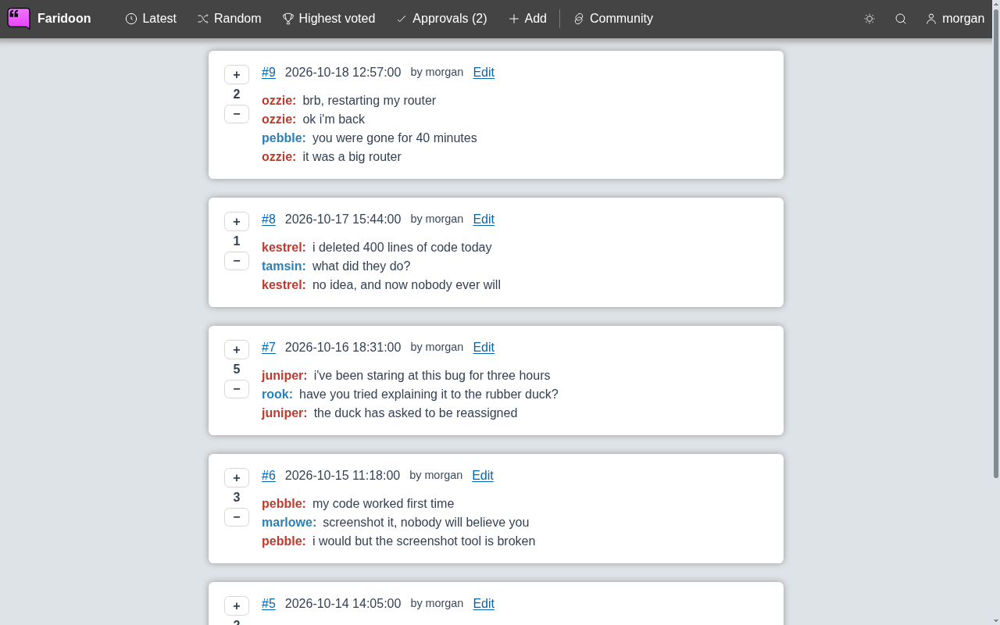
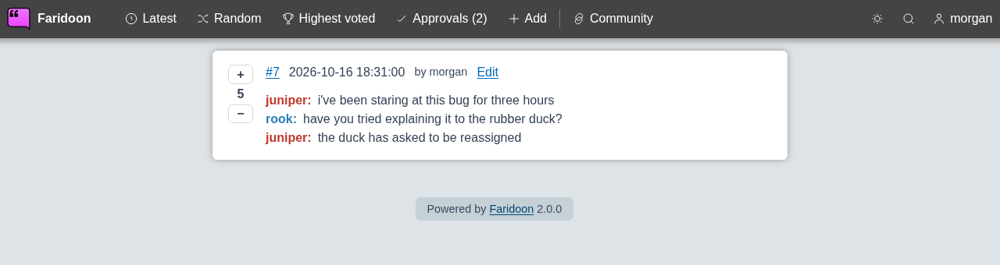
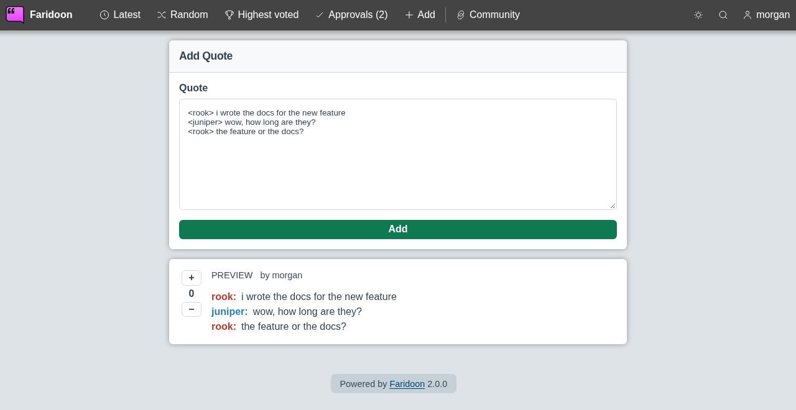
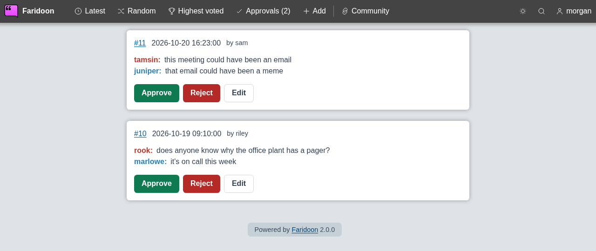
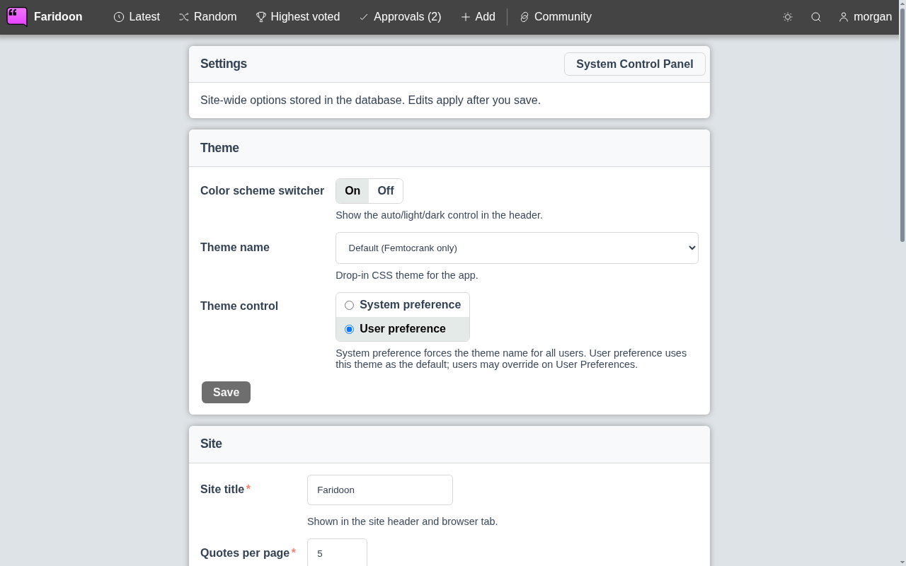
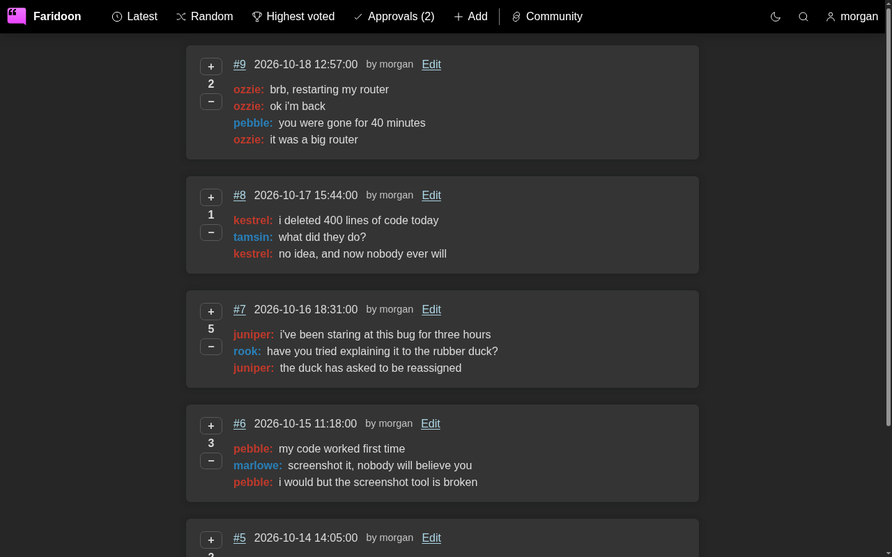

  
  <h1>Faridoon</h1>

  Easily save and publish your favourite chat quotes for others to see.

Documentation for how to install and use Faridoon is available at https://jamesread.github.io/Faridoon/

## Screenshots

### Latest quotes

The front page lists the newest quotes, with each chat username highlighted in its own colour. Signed-in users can vote quotes up or down.

### Quote permalink

Every quote has its own page, so a favourite exchange is easy to link to and share.

### Add a quote

Paste a chat log and a live preview shows exactly how the quote will look before it is submitted.

### Approval queue

Quotes from guests and regular users wait in an approval queue, where moderators can approve, reject or tidy them up before they go live.

### Settings

Admins configure the site from the browser, including the site title, voting, registration, guest submissions and theme, with no config files to edit.

### Dark mode

A built-in dark theme, which users can switch to from the header.

Screenshots use fictional test data and are regenerated with `make screenshots`
(see [`var/marketing/screenshots`](var/marketing/screenshots/README.md)).

## Getting Started

Documentation is available at: https://jamesread.github.io/Faridoon/ , the recommended installation method is via **Docker**, connected to a **MySQL Database**. Faridoon runs just fine with low system resources - 1 vCPU and a 1 GB of RAM is plenty.

## Stack

* Go service with ConnectRPC
* Vue 3 + Vue Router + [picocrank](https://www.npmjs.com/package/picocrank) UI components
* MySQL schema managed with **sql-migrate**
* Authentication via [httpauthshim](https://github.com/jamesread/httpauthshim) (sessions; users stored in MySQL)

## Features

* Automatic highlighting of usernames.
* Semi-intelligent removal of line breaks and weird characters.
* User login and registration, with admins and privilege-based moderators.
* Approval queue for guest and non-privileged submissions (reject deletes the quote).
* Admin Settings (database cvars) for site title, voting, registration, guest add, and syntax highlighting.
* Header links, webhooks (`approval.requested`), audit logs, and diagnostics.
* YAML config for listen/database/auth; environment variables for database connectivity (and a few bootstrap values).

## **Faridoon is a No-Nonsense Open Source project;**

- All code and assets are Open Source (AGPL).
- No company is paying for development, there is no paid-for support from the developers.
- No separate core and premium version, no plus/pro version or paid-for extra features.
- No SaaS service or "special cloud version".
- No "anonymous data collection", usage tracking, user tracking, telemetry or email address collection.
- No requests for reviews in any "app store" or feedback surveys.
- No prompts to "upgrade to the latest version".
- No internet-connection required for any functionality.

## Docs

Documentation for how to install and use Faridoon is available at https://jamesread.github.io/Faridoon/
